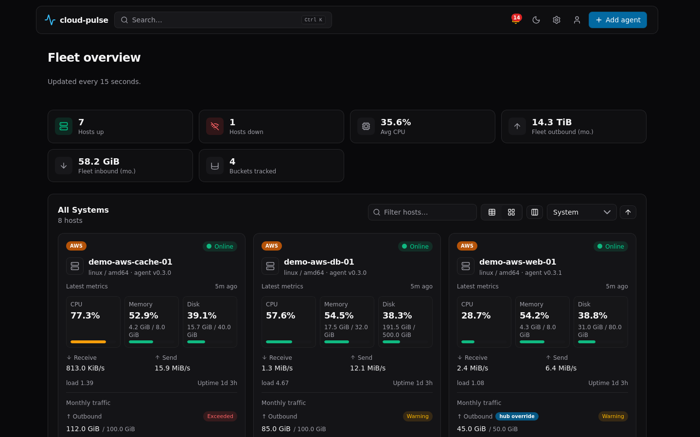

# cloud-pulse

Ultra-lightweight, CGO-free server monitor for small fleets — a
Beszel-inspired hub + agent, one static binary each, no runtime
dependencies, an embedded SQLite database, and a dashboard baked into
the binary.

[](https://github.com/leejeonghun001/cloud-pulse/actions/workflows/ci.yml)
[](https://github.com/leejeonghun001/cloud-pulse/actions/workflows/notify-e2e.yml)
[](https://github.com/leejeonghun001/cloud-pulse/releases)
[](LICENSE)
[](go.mod)



More screenshots: [host detail](docs/screenshots/host-detail.png) ·
[Activity](docs/screenshots/alerts.png) ·
[mobile onboarding](docs/screenshots/mobile-overview.png) ·
[masked install guide](docs/screenshots/add-agent.png) ·
[notification test](docs/screenshots/notifications.png) ·
[illustrative costs](docs/screenshots/costs.png) ·
[Korean overview](docs/screenshots/ko/ko-overview.png) ·
[mobile (earlier capture)](docs/screenshots/mobile.png) ·
[settings](docs/screenshots/settings.png) ·
[rollout](docs/screenshots/rollout.png) ·
[channel health](docs/screenshots/notifications-health.png)

The refreshed overview, detail and Activity images use demo metrics, inventory
and historical event fixtures, not real incidents or provider truth. Mobile
onboarding uses a browser-only empty-host response over a seeded sandbox, not
an empty backend. The install command/token stays masked. The notification
result is a browser stub: nothing was sent or delivery verified, and recorded
health is unchanged. Costs are illustrative billing fixtures, not live charges.
The earlier mobile, settings, rollout and channel-health images are unchanged.

## Features

- **15-second host metrics**: CPU, memory (true "available"), disk
  usage + IO, network rates, load average — pushed by a single-binary
  agent over HTTP(S). Runs on **Linux, macOS, and Windows**.
- **Outbound and inbound egress accounting**, tracked and alerted on
  separately, with provider-aware free-tier defaults (AWS 100 GB, OCI
  10 TB), overridable per host from the hub.
- **Hub-synchronized, aligned sampling**: a whole fleet's samples share
  identical timestamps regardless of each host's own clock drift.
- **Dashboard sign-in**: a single `admin` account, PBKDF2-hashed
  password, server-side sessions, per-IP + fleet-wide login rate
  limiting, and a `reset-password` recovery CLI.
- **Settings UI**: reveal the agent token and copy a ready-to-run
  install command (per OS), edit per-host egress/ingress limit
  overrides, manage notification channels, and configure the hub's own
  listen address(es) and access allowlist.
- **Cloud object storage monitoring**: Amazon S3 (via CloudWatch),
  Cloudflare R2 (via GraphQL Analytics), and — since v0.7.0 — personal
  **Google Drive / Dropbox** quota via OAuth.
- **Cloud cost polling**: AWS Cost Explorer / OCI Usage API via the
  `aws`/`oci` CLI, plus a configurable network-egress cost estimate
  independent of real billing.
- **Alerting** with chart images to Discord, Telegram, and WhatsApp:
  configurable rules (CPU/memory/disk/load average/egress/host-down/
  storage-usage, plus agent-outdated and failed update batches)
  through a persistent state machine.
- **Notification channel health**: an opt-in weekly test message per
  channel, 7/30-day delivery success rates, and a "channel X is
  failing" alert sent through a different, healthy channel (or a
  dashboard banner when none is left).
- **Inventory**: Docker/Podman containers and listening ports per host.
- **Remote agent updates**: trigger `update` on a batch of hosts from
  the dashboard (Linux >= v0.6.0, macOS/Windows >= v0.7.0), opt-in only,
  request-only from the hub's side. The **Rollout** page shows versions
  per OS, outdated hosts, batch history, and updates every opted-in
  outdated host in one confirmed batch.
- **English and Korean**: dashboard language per browser (Settings →
  General, also on the sign-in page) and a separate hub-wide language
  for notification messages.
- **Single static binaries**, `CGO_ENABLED=0` always, no AWS SDK
  (hand-written SigV4), embedded SQLite with rollups and automatic
  retention pruning.
- **Embedded dashboard** — vanilla ES modules + vendored uPlot charts +
  prebuilt Tailwind CSS, no Node.js needed to run the hub, no CDN calls
  at runtime, responsive down to a 360px viewport, light/dark themes.

## Architecture

Agents initiate authenticated metric/inventory reports to the hub; no
inbound access to agents is needed, so they work behind NAT/CGNAT (a
[Tailscale](https://tailscale.com) mesh is recommended). The hub stores
state in embedded SQLite, serves its embedded dashboard, and contacts
external services only for enabled/configured integrations. See
[docs/architecture.md](docs/architecture.md) for the flow diagram and
[docs/api.md](docs/api.md) for the public, agent, and dashboard API auth
classes.

## Quick start

### Hub (Linux)

```bash
curl -fsSL https://raw.githubusercontent.com/leejeonghun001/cloud-pulse/main/scripts/install-hub.sh \
  | sudo bash
```

Run at a real terminal with no flags for an interactive menu; pipe a
flag (e.g. `-- --install --yes`) for non-interactive/CI use. See
[docs/install.md](docs/install.md) for every flag and both paths in
detail.

### Agent — Linux / macOS

```bash
curl -fsSL https://raw.githubusercontent.com/leejeonghun001/cloud-pulse/main/scripts/install-agent.sh \
  | sudo bash -s -- --hub-url http://<hub-ip>:8090 --token <printed-token>
```

Same script auto-detects Linux (systemd) vs. macOS (launchd, stock
`/bin/bash` 3.2 compatible).

### Agent — Windows

Run as Administrator in PowerShell:

```powershell
& ([scriptblock]::Create((irm https://raw.githubusercontent.com/leejeonghun001/cloud-pulse/main/scripts/install-agent.ps1))) -Install -HubUrl http://<hub-ip>:8090 -Token <printed-token> -Yes
```

Registers `cloud-pulse-agent` as a Windows service under a virtual
service account. See [docs/install.md](docs/install.md) for paths,
permissions, and the `-RemoteUpdate` opt-in.

### Upgrade

```bash
sudo cloud-pulse-hub update
sudo cloud-pulse-agent update       # Linux/macOS
```

```powershell
cloud-pulse-agent.exe update        # Windows, elevated
```

Upgrade the hub first, then agents. Full legacy-version migration path
(pre-v0.3.1) and per-OS notes: [docs/upgrade.md](docs/upgrade.md).

### Uninstall

```bash
curl -fsSL .../install-hub.sh | sudo bash -s -- --uninstall [--purge]
curl -fsSL .../install-agent.sh | sudo bash -s -- --uninstall [--purge]
```

```powershell
& ([scriptblock]::Create((irm .../install-agent.ps1))) -Uninstall [-Purge] -Yes
```

Details: [docs/install.md](docs/install.md#uninstall).

## Local development (specimen)

This **local-development specimen** is not a production/deployment recipe or
supported image. It builds only the hub, persists embedded SQLite in a named
volume, and has no agents, provider/notification credentials, custom endpoints,
or remote agents. `CP_UPDATE_CHECK=false`/`CP_BILLING=off` apply only here.
Docker source IP varies; never widen the bridge allowlist to `*`. Inspect the
observed source; on subnet conflict, change Compose IPAM and `.env` CIDR together.

### Docker Compose

Requires Docker Engine and Compose v2. The project builds a local image; no
published image is implied. Create a private local env file and generate a
64-hex-character random agent token (the command refuses to overwrite `.env`):

```bash
if [ -e .env ]; then
  printf '%s\n' '.env already exists; refusing to overwrite it' >&2
  exit 1
fi
(umask 077; cp .env.example .env)
python3 -c 'from pathlib import Path; import secrets; p=Path(".env"); s=p.read_text(); old="CP_AGENT_TOKEN=\n"; assert s.count(old) == 1; p.write_text(s.replace(old, "CP_AGENT_TOKEN=" + secrets.token_hex(32) + "\n", 1))'
```

Validate without printing the expanded token-bearing environment, then
build/start the hub, check health, and open the sign-in page:

```bash
docker compose --env-file .env config --quiet
docker compose --env-file .env up --build -d
curl --noproxy '*' --connect-timeout 2 --max-time 5 --fail http://127.0.0.1:18091/healthz
```

Sign in at <http://127.0.0.1:18091/login> as `admin` / `changeme`; the first
login requires changing that well-known default password before other pages
or APIs are available. Stop the service without deleting its data with:

```bash
docker compose --env-file .env down
```

The named volume remains after `down`; do not add `-v` unless intentionally
deleting this specimen's local database. Docker host-source translation,
bridge routing, and IPv4 subnet availability are engine/OS dependent; this
sample is not evidence of runtime compatibility on other hosts.

### Native source smoke (offline)

This offline smoke uses the installed Go toolchain/module cache and disposable
paths, contacting loopback only. It checks health, first-login password-change
enforcement, rotation, and access. Harness-only `SMOKE_PORT` defaults to `18091`,
validates loopback/unprivileged ports and rejects `8090`; it is not a CP setting.

```bash
set -eu
tmp="$(mktemp -d)"
SMOKE_PORT="${SMOKE_PORT:-18091}"
SMOKE_PORT="$(python3 -c 'import socket,sys; raw=sys.argv[1]; port=int(raw,10) if raw.isascii() and raw.isdigit() else -1; (1024 <= port <= 65535 and port != 8090) or sys.exit("SMOKE_PORT must be 1024..65535 except 8090"); s=socket.socket(); s.setsockopt(socket.SOL_SOCKET, socket.SO_REUSEADDR, 1); s.bind(("127.0.0.1", port)); s.close(); print(port)' "$SMOKE_PORT")"
SMOKE_ADDR="127.0.0.1:$SMOKE_PORT"
SMOKE_BASE_URL="http://$SMOKE_ADDR"
export SMOKE_PORT SMOKE_ADDR SMOKE_BASE_URL
pid=
cleanup() {
  status=$?
  trap - EXIT
  if [ -n "$pid" ]; then
    if kill -0 "$pid" 2>/dev/null; then
      kill -TERM "$pid" 2>/dev/null || true
      ticks=0
      while [ "$ticks" -lt 3 ] && kill -0 "$pid" 2>/dev/null; do
        sleep 1
        ticks=$((ticks + 1))
      done
      if kill -0 "$pid" 2>/dev/null; then
        kill -KILL "$pid" 2>/dev/null || true
      fi
    fi
    wait "$pid" 2>/dev/null || true
  fi
  rm -rf "$tmp"; exit "$status"
}
trap cleanup EXIT
trap 'exit 130' INT
trap 'exit 143' TERM
GOTOOLCHAIN=local GOPROXY=off GOSUMDB=off CGO_ENABLED=0 go build -trimpath -o "$tmp/cloud-pulse-hub" ./cmd/hub
mkdir -m 700 "$tmp/data"
mkdir -m 700 "$tmp/home" "$tmp/tmp"
token="$(python3 -c 'import secrets; print(secrets.token_hex(32))')"
env -i PATH=/usr/bin:/bin TMPDIR="$tmp/tmp" HOME="$tmp/home" \
  CP_AGENT_TOKEN="$token" \
  CP_LISTEN="$SMOKE_ADDR" \
  CP_DATA_DIR="$tmp/data" \
  CP_ALLOWED_CIDRS=127.0.0.0/8,::1/128 \
  CP_UPDATE_CHECK=false CP_BILLING=off \
  "$tmp/cloud-pulse-hub" >"$tmp/hub.log" 2>&1 &
pid=$!; unset token
ready=
for _ in $(seq 1 40); do
  if curl --noproxy '*' --connect-timeout 1 --max-time 2 \
      --fail --silent "$SMOKE_BASE_URL/healthz" >/dev/null; then
    ready=1
    break
  fi
  sleep 0.25
done
test "$ready" = 1
python3 - <<'PY'
import json
import os
import secrets
import urllib.error
import urllib.request

base = os.environ["SMOKE_BASE_URL"]
opener = urllib.request.build_opener(urllib.request.ProxyHandler({}))

def request(path, method="GET", token=None, payload=None):
    headers = {}
    body = None
    if token:
        headers["Authorization"] = "Bearer " + token
    if payload is not None:
        headers["Content-Type"] = "application/json"
        body = json.dumps(payload).encode()
    req = urllib.request.Request(base + path, data=body, headers=headers, method=method)
    try:
        with opener.open(req, timeout=5) as response:
            return response.status, json.loads(response.read())
    except urllib.error.HTTPError as error:
        return error.code, json.loads(error.read())

status, login = request("/api/v1/auth/login", "POST", payload={"username": "admin", "password": "changeme"})
assert status == 200 and login["must_change_password"] is True
status, _ = request("/api/v1/hosts", token=login["token"])
assert status == 403, f"must-change gate returned {status}, expected 403"
status, changed = request("/api/v1/auth/password", "POST", token=login["token"], payload={
    "current_password": "changeme",
    "new_password": secrets.token_urlsafe(24),
})
assert status == 200 and changed["must_change_password"] is False
status, _ = request("/api/v1/hosts", token=changed["token"])
assert status == 200, f"post-change access returned {status}, expected 200"
print("PASS login admin/changeme -> must-change=true; GET hosts -> 403; password change -> must-change=false; GET hosts -> 200")
PY
python3 -c 'import hashlib, pathlib, sys; p=pathlib.Path(sys.argv[1]); print(hashlib.sha256(p.read_bytes()).hexdigest(), p)' "$tmp/cloud-pulse-hub"
```

The trap stops the temporary hub and removes only its temporary directory.
This source smoke is not a Docker/Compose runtime check.

## Documentation

| Doc | Covers |
|---|---|
| [docs/install.md](docs/install.md) | Every install flag, every platform, uninstall |
| [docs/upgrade.md](docs/upgrade.md) | Upgrade flows (current and legacy), update notifications |
| [docs/configuration.md](docs/configuration.md) | Every `CP_*` env var and CLI flag, hub and agent |
| [docs/security.md](docs/security.md) | Sign-in, sessions, network settings, the full security model |
| [docs/billing.md](docs/billing.md) | AWS/OCI cloud cost polling, network cost estimates, KRW display |
| [docs/storage.md](docs/storage.md) | Google Drive/Dropbox OAuth setup, app registration, privacy |
| [docs/alerting.md](docs/alerting.md) | Alert rule model, state machine, chart images |
| [docs/notifications.md](docs/notifications.md) | Discord/Telegram/WhatsApp/webhook setup, real-account E2E verification |
| [docs/remote-updates.md](docs/remote-updates.md) | Batch agent updates, security model, per-platform mechanics |
| [docs/api.md](docs/api.md) | Full REST API reference |
| [docs/architecture.md](docs/architecture.md) | Package layering, time sync, egress accounting, inventory |
| [docs/troubleshooting.md](docs/troubleshooting.md) | Common problems and how to diagnose them |

Contributing (setup, adding a metric/notifier/storage provider/page,
release process): [CONTRIBUTING.md](CONTRIBUTING.md). Architecture and
security conventions: [CODING_CONVENTIONS.md](CODING_CONVENTIONS.md).
Design decisions and rationale: [DECISIONS_LOG.md](DECISIONS_LOG.md); local performance baseline: [docs/performance.md](docs/performance.md).
Security vulnerability reporting: [SECURITY.md](SECURITY.md).

```bash
make hooks   # git config core.hooksPath .githooks (run once after cloning)
make build   # build bin/cloud-pulse-hub + bin/cloud-pulse-agent
make test    # go test ./... (CGO_ENABLED=0)
make lint    # full pre-commit check suite on demand
```

## Comparison / inspiration

cloud-pulse takes direct inspiration from
[Beszel](https://github.com/henrygd/beszel), a lightweight server
monitoring hub/agent written in Go. The main differences: cloud-pulse
agents **push** metrics over HTTP(S) with a pre-shared token instead of
the hub pulling over SSH (simpler behind NAT/CGNAT, especially on a
Tailscale mesh), and cloud-pulse adds first-class cloud egress
accounting, S3/R2/Google Drive/Dropbox storage monitoring, and cloud
cost polling that Beszel doesn't target.

## License

[MIT](LICENSE)
