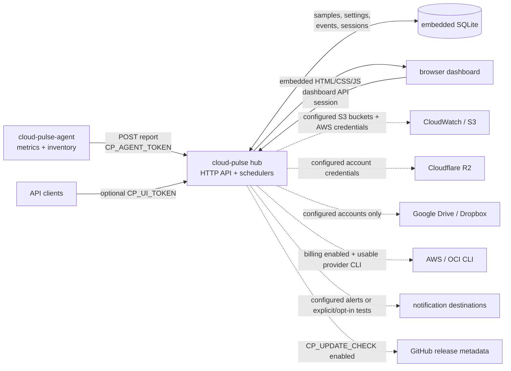

# Architecture

**Text fallback:** Agents initiate HTTPS/HTTP report requests with the
`CP_AGENT_TOKEN`; the hub stores reports and dashboard state in SQLite
and serves the dashboard from embedded assets. The browser calls the
hub API using a dashboard session (or `CP_UI_TOKEN` for API clients).
At startup the hub indexes every embedded asset once, calculating a strong
ETag and retaining a smaller gzip variant for compressible files; dashboard
responses still use `Cache-Control: no-cache`, so an upgraded binary is picked
up on the next revalidation without re-downloading unchanged bytes.
There is no inbound connection to an agent. External service activity
depends on configuration: S3/R2 collectors need their configured
credentials and buckets/accounts; Drive/Dropbox polling runs only for
accounts configured in the hub; billing runs only when enabled (set
`CP_BILLING=off` to disable it); notification sends require configured
channels and an alert, test, or enabled synthetic-test schedule. The
separate release lookup is controlled by `CP_UPDATE_CHECK` (enabled by
default). These are optional/configuration-dependent integrations, not
unconditional calls to every provider. See [configuration.md](configuration.md)
for the settings and [api.md](api.md) for route authentication.

## Layering

Dependencies point inward, following a Clean-Architecture-style split:

- `internal/models`: standard-library-only data types shared by every
  other package (no dependency on `internal/hub`, `internal/agent`,
  storage, etc.).
- `internal/config`: environment/flag loading for both binaries.
- `internal/storage`: SQLite persistence (`modernc.org/sqlite`, WAL
  mode, no CGO), migrations, and the `Store` interface's concrete
  implementation.
- `internal/hub`: the HTTP server, route handlers, and the various
  background schedulers (billing, storage, alert evaluation, update
  checks). Depends on `internal/models` and the `Store` interface
  (satisfied by `internal/storage` in production, by an in-memory fake
  in tests).
- `internal/agent`: collection (gopsutil-backed), the report buffer/
  sender, self-update integration, and platform service glue (Windows
  service handler, launchd-adjacent helpers).
- `internal/alerting`, `internal/notify`, `internal/billing`,
  `internal/storageusage`, `internal/cloud`: feature-specific business
  logic, each testable in isolation against fakes.
- `internal/channelhealth`: notification channel health — the weekly
  synthetic-test scheduler and runner, delivery statistics, the
  healthy/degraded/failing state, and fallback-channel selection.
- `internal/i18n`: English/Korean catalogs for hub-generated
  notification text, selected by the `notify_language` setting. The
  dashboard's own catalogs live in `web/assets/i18n/`.
- `internal/poller`: the generic quiet-skip polling framework shared by
  the billing and storage-usage collectors (scheduler with injected
  clock, rate-limited manual refresh, freshness tracking, last-success
  snapshot retention, once-per-day reason logging).
- `internal/systemdunit` / `internal/launchd`: Go-rendered service
  definitions for Linux/macOS, each with a golden-tested `Render` and
  an idempotent `Apply` that re-renders an installed unit/plist only if
  it has drifted.
- `internal/selfupdate`: the shared self-update pipeline (`update` on
  both binaries, plus the remote-update request-processing path).
- `cmd/hub`, `cmd/agent`: thin entry points; the only place `os.Exit` is
  called in non-test code.
- `web/`: the embedded dashboard (vanilla ES modules + vendored uPlot +
  prebuilt Tailwind CSS, no Node.js needed to run the hub, no CDN calls
  at runtime).

## Time synchronization

Agents in a fleet can have clocks that drift independently. Since v0.2,
sample timestamps are synchronized across the whole fleet to a single
reference: **the hub's clock**.

- **The hub host should run NTP** (e.g. `systemd-timesyncd`) — it's
  just the fleet's agreed-upon reference clock, so its own accuracy
  matters.
- **Offset estimation is NTP-style**: before its first sample, and
  after every report, an agent measures its local send/receive time
  around a request to the hub and computes `offset = server_time -
  midpoint(t0, t1)`. It keeps the last 8 such observations and uses the
  one with the smallest round-trip time as its current best offset
  estimate. Samples with RTT `> 5s` or negative are discarded.
- **Sampling is epoch-aligned**: each agent collects at the next
  hub-time boundary that's a multiple of the interval (e.g.
  `:00/:15/:30/:45` for a 15s interval) — a whole fleet's samples share
  identical `ts` values for the same collection round, regardless of
  when each agent process actually started.
- **Backward compatible**: an old agent talking to a new hub keeps
  working unmodified. A new agent talking to an old hub gets a 404 from
  `GET /api/v1/agent/time`, logs once, and falls back to its own clock.
- Set `CP_TIME_SYNC=local` to disable hub-clock correction entirely.

## Egress accounting

Outbound (egress/TX) and inbound (ingress/RX) traffic are tracked and
alerted on **separately**, approximated as the sum of byte deltas on
physical network interfaces, accumulated per UTC calendar month.
Virtual/tunnel interfaces are excluded by default via `CP_NET_EXCLUDE`.

This is an **approximation**, not a billing-accurate figure:
intra-region/intra-VPC traffic is counted the same as internet egress
even though many providers don't bill for it; AWS's real 100 GB free
tier is aggregated account-wide, not per host, but cloud-pulse tracks
each host independently (same caveat for OCI's 10 TB tenancy-wide free
tier); the projected month-end figure is a simple linear projection,
not a forecast accounting for traffic patterns.

Limits: outbound keeps AWS/OCI provider defaults, overridable per
agent via `CP_EGRESS_LIMIT_GB`; inbound has no provider default —
unlimited unless configured. Both can be overridden per host from the
hub (`PUT /api/v1/hosts/{id}/limits`), taking precedence over the
agent-reported value. See [alerting.md](alerting.md) for the
80/95/100% threshold alerts this feeds.

## Inventory: Docker services + listening ports

Every 60 seconds, the agent collects listening network sockets (every
TCP socket in `LISTEN` state, every bound UDP socket) and, if Docker or
Podman is available, running containers — attached to a report
whenever it has changed or every 10 minutes, whichever comes first. See
[storage.md](storage.md#docker--podman-inventory-privilege-tradeoff)
for the `CP_DOCKER` privilege tradeoff.
