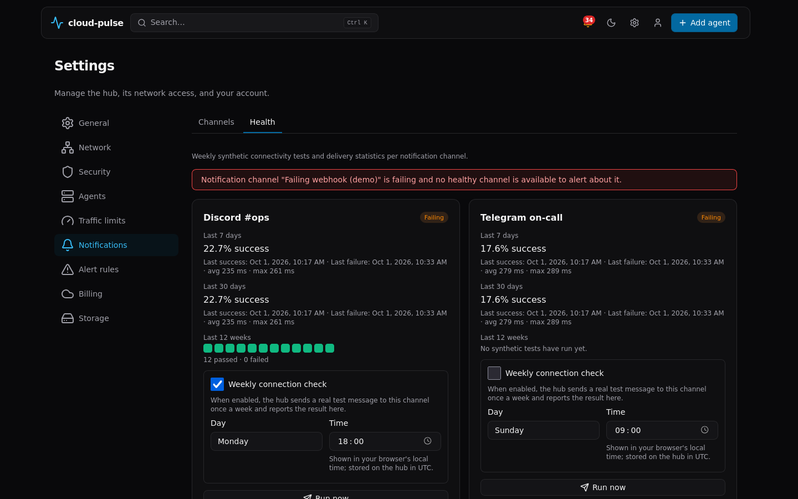

# Notifications

A notify channel is a saved destination — Discord, Telegram, WhatsApp,
or a generic webhook — that one or more [alert rules](alerting.md) can
deliver to. Channels are managed via `GET/POST
/api/v1/alerts/channels` and `PUT/DELETE
/api/v1/alerts/channels/{id}`, or from the dashboard's Settings →
Notifications page.

Notification message bodies (and chart titles, though not the chart
image's own text — see [alerting.md](alerting.md#chart-images)) are
rendered in the language set by the hub-wide `notify_language` setting
(`en`/`ko`, default `en` — Settings → General → Notification language,
or `GET/PUT /api/v1/settings/notify-language`, SPEC-v0.8 §3-3),
independent of any signed-in admin's own dashboard language preference.
A change applies to the next message. With `ko`, webhook payloads carry
Korean `title`/`text` and Korean `fields[].name` labels; the JSON keys
and machine values (`fields[].value` for metric and state, `severity`)
never change.

## Discord

**Setup**: Server Settings → Integrations → Webhooks → New Webhook →
copy the Webhook URL.

**Config**: `webhook_url` (secret) — must be `https://discord.com/...`
or `https://discordapp.com/...`.

**Delivery**: Discord's "Execute Webhook" endpoint, multipart/form-data
— an embed plus a PNG chart attachment when available.

## Telegram

**Setup**: message [@BotFather](https://t.me/botfather) → `/newbot` →
copy the bot token. Add the bot to the target chat, send it any
message, then open `https://api.telegram.org/bot<TOKEN>/getUpdates`
and read `"chat":{"id": ...}` for the `chat_id`.

**Config**: `bot_token` (secret), `chat_id`, optional
`message_thread_id`.

**Delivery**: `sendPhoto` (caption <= 1024 chars, HTML) when a chart is
attached, else `sendMessage`.

## WhatsApp (Meta Cloud API)

**Setup**: [Meta for Developers](https://developers.facebook.com) →
create an app → add the WhatsApp product → API Setup tab → copy the
access token and Phone Number ID. Add the recipient as an allowed
tester number while using a temporary token. **Recommended**: get an
approved message template with an image header so alerts can be
delivered outside the 24-hour customer-service window.

**Config**: `access_token` (secret), `phone_number_id`, `to` (E.164
digits only), optional `template_name`, `template_lang`, `api_version`.

## Webhook (generic)

A JSON POST with `text`/`content`/`title`/`severity`/`fields`/`url`,
and — when `include_image` is set — an `image_png_base64` field.
Requires `https://` unless custom endpoints are allowed (test/CI only).

## Send-test diagnosis

A failed **Send test** (`POST /api/v1/alerts/channels/{id}/test`)
responds with a classified `Diagnosis{code, title, detail, hint,
docs_url}` instead of a bare error string — every field is guaranteed
to redact known channel credentials and configured endpoint URLs (including
short tokens) in error-derived text. Classification uses the original
typed error, so DNS, timeout and rate-limit codes remain meaningful. See
`internal/notify/diagnose.go` for the
full code table (DNS/network/TLS failures, and per-platform codes like
`discord_webhook_not_found`, `telegram_chat_not_found`,
`whatsapp_window_closed`, etc.).

`POST /api/v1/alerts/channels/test` also accepts an unsaved draft:
`{name, type, enabled, config, existing_channel_id?}`. The optional
`existing_channel_id` must be a positive integer identifying a saved channel
of the **same type** (admin-only; missing channel: 404). Only omitted or
`"***"` secret fields are taken from that saved channel; edited destinations
and replacement secrets remain the draft's values. Without an ID, provide
real required secrets, not `"***"`. The merged draft is validated before
testing, never saved, and its config/secrets are never returned. A failed
send returns HTTP 200 with `ok: false` and diagnosis; invalid input or sender
configuration returns 400. The saved-channel `/channels/{id}/test` contract
is unchanged.

## Health report



Settings → Notifications → **Health** tab (SPEC-v0.8 §3-2) shows each
channel's current health state — `healthy`, `degraded`, `failing`, or
`unknown` (not enough data yet) — computed by
`models.ComputeChannelHealthState` from two independent signals:

1. **Delivery statistics**: 7-day and 30-day success rate, last
   success/failure time, last failure's diagnosis code, and average/
   max delivery latency, all derived from the same `alert_events`
   delivery records `GET /api/v1/alerts/events` already returns — no
   separate delivery log exists. A channel with 90%+ 7-day success is
   `healthy`; 50-90% is `degraded`; below 50% is `failing`.
2. **Weekly synthetic test** (opt-in per channel, default off): a
   toggle plus a weekday and time-of-day in the channel's edit dialog.
   The stored schedule is always UTC — the dialog converts to/from your
   browser's local time for display only, so the same schedule reads
   correctly regardless of which admin's browser is looking at it, and
   is entirely unaffected by daylight-saving transitions on either
   end. **A missed run (hub was offline at the scheduled time) runs
   once at the next startup that falls within about an hour of the
   missed slot — never multiple catch-up runs for multiple missed
   weeks.**

   The synthetic test sends a real message through the exact same
   `internal/notify` send path as `cloud-pulse-hub notify verify` (see
   below) — **this means enabling it will send a real message to your
   Discord/Telegram/WhatsApp destination once a week**, not a simulated
   check. Discord messages are independently read back and then deleted
   best-effort. Telegram has no read-back API: it is reported `accepted`
   after a successful send, with a best-effort delete. WhatsApp uses a
   generated demo PNG (not photos or host data); WhatsApp and generic
   webhooks are reported `accepted` after API success, **not proof of
   delivery to a recipient**. They have no message cleanup step, so test
   messages may remain. Cleanup failure or an exhausted deadline can also
   leave Discord/Telegram messages behind. The whole synthetic run has a
   20s default deadline shared by send/read-back/delete; the synchronous
   run-now route, including store work and fallback dispatch, is capped at
   25s (a shorter request deadline wins). The result — outcome
   (`accepted`/`verified`/`failed`), a diagnosis code on failure, and a
   short redacted detail string — is stored and shown as a 12-week strip
   of colored/labeled results (with a text alternative for screen
   readers) on the channel's card, alongside a **Run now** button that
   triggers the same test immediately via `POST
   /api/v1/alerts/channels/{id}/synthetic-test`.

A synthetic-test failure, or three consecutive failed alert deliveries,
also triggers the [channel-failure fallback
notification](alerting.md#channel-failure-fallback-notification) — a
"channel X is failing" message sent through a different healthy
channel (or a dashboard banner if none exists).

Error-derived synthetic detail strings use channel-aware redaction before
persistence and API display. This is not a general guarantee for arbitrary
operator-entered text: do not put credentials in channel names or message
content. WhatsApp fallback notifications also attach the same generated demo
chart; their successful send means API acceptance, not delivery proof, and
they remain subject to template approval/the 24-hour window.

## Real-account end-to-end verification

Automated tests use `httptest` fakes for every platform — nothing in
CI's normal test suite ever contacts a real Discord/Telegram/WhatsApp
endpoint. Two tools exist specifically to close that gap by sending a
real message through the exact same code path the hub's own alert
delivery uses:

### `cloud-pulse-hub notify verify`

```bash
cloud-pulse-hub notify verify --credentials-file /path/to/creds.env \
  --platform all --cleanup --json
```

This CLI drives the hub's real `internal/notify` senders and the real
`internal/alerting/chart` renderer — the same message-construction and
HTTP-delivery code the hub's own alert engine uses, not a separate
reimplementation. `--platform discord|telegram|whatsapp|all` selects
which configured platforms to test (a platform with no credentials
configured is reported `skipped`, never a failure). `--cleanup` deletes
the sent message afterward where the platform supports it. `--timeout`
overrides the default 20s per-request timeout: send, read-back and cleanup
each get their own allowance. WhatsApp delivery-status waiting has a separate
`--status-webhook-wait` budget (default 60s), not clipped by `--timeout`; a shorter
parent context deadline still applies. `--json` prints a
machine-readable `NotifyVerifyReport`.

**Credentials** are read only from `CP_VERIFY_*` environment variables
or a `--credentials-file` (a `KEY=VALUE` file, permission-checked to
`0600` or stricter) — never from a command-line argument value:

| Variable | Platform |
|---|---|
| `CP_VERIFY_DISCORD_WEBHOOK_URL` | Discord |
| `CP_VERIFY_TELEGRAM_BOT_TOKEN`, `CP_VERIFY_TELEGRAM_CHAT_ID` | Telegram |
| `CP_VERIFY_WHATSAPP_ACCESS_TOKEN`, `CP_VERIFY_WHATSAPP_PHONE_NUMBER_ID`, `CP_VERIFY_WHATSAPP_TO`, `CP_VERIFY_WHATSAPP_TEMPLATE_NAME`, `CP_VERIFY_WHATSAPP_TEMPLATE_LANG`, `CP_VERIFY_WHATSAPP_APP_SECRET` | WhatsApp |

### What the read-back proves — and what it cannot

| Platform | Read-back method | What it proves | What it cannot prove |
|---|---|---|---|
| Discord | Executes the webhook with `?wait=true`, receives the created message object back, then `GET /webhooks/{id}/{token}/messages/{message_id}` | The message exists server-side with the chart attachment present | Whether any human ever saw it in the channel |
| Telegram | No independent read-back; checks `sendPhoto`'s response identifiers and photo metadata | API acceptance (`accepted`, not `verified`) and response-shape attachment confirmation | No API to re-fetch its own sent message or prove recipient delivery |
| WhatsApp | Checks the media-upload response's media ID and `messages[0].id`/`message_status` (`accepted`) from the send call | The Graph API accepted the message for delivery | **Real delivery cannot be confirmed this way** — `accepted` only means Meta queued it, not that WhatsApp delivered or the recipient's client received it. An optional `--status-webhook-listen :PORT` can receive Meta's own delivery-status webhook callbacks if you've configured one on your Meta app, but this requires a publicly reachable listener and is not exercised by default |

### `.github/workflows/notify-e2e.yml`

A GitHub Actions workflow that runs `cloud-pulse-hub notify verify
--platform all --cleanup --json` against **real** Discord/Telegram/
WhatsApp accounts, using repository secrets:

- Triggers: `workflow_dispatch` (run on demand) and a weekly schedule
  (Monday 03:00 UTC). **Never runs on `pull_request`** — forked PRs
  never receive secrets, and this workflow must never be triggerable
  from an untrusted branch.
- **Secrets to add** (repository Settings → Secrets and variables →
  Actions), one per platform you want covered — any platform whose
  secrets are absent reports `skipped`, not a failure:
  - `CP_VERIFY_DISCORD_WEBHOOK_URL`
  - `CP_VERIFY_TELEGRAM_BOT_TOKEN`, `CP_VERIFY_TELEGRAM_CHAT_ID`
  - `CP_VERIFY_WHATSAPP_ACCESS_TOKEN`,
    `CP_VERIFY_WHATSAPP_PHONE_NUMBER_ID`, `CP_VERIFY_WHATSAPP_TO`,
    `CP_VERIFY_WHATSAPP_TEMPLATE_NAME`
- The credentials file is written to `RUNNER_TEMP` with `umask 077`
  (mode `0600`) and deleted in an `if: always()` step regardless of job
  outcome.
- The job summary shows a per-platform result table (status, whether
  read-back/cleanup was attempted, and diagnosis code on failure) built
  from the same secret-free `NotifyVerifyReport` JSON, followed by the
   raw JSON for anyone who wants it — error-derived fields are redacted
   using the configured channel's credentials and endpoint URLs. Do not
   include credentials in operator-controlled names or content. The
   README's CI badge row links a matching
  `notify-e2e.yml` status badge so this workflow's latest run is
  visible without opening the Actions tab.
- **Do not paste real tokens into chat, issues, or commits.** Add them
  directly as repository secrets through GitHub's own UI.

### `scripts/verify-notify.py`

A pure-Python equivalent for environments without a Go toolchain,
covering the same credential-input rules (env vars or a `0600`
credentials file, never argv) plus Discord read-back and Discord/Telegram
`--cleanup`. The Go CLI above is the primary, recommended path since it
exercises the hub's actual production code, not a parallel
reimplementation; this script exists for operators who only have the
release binaries, not a Go build environment.

```bash
python3 scripts/verify-notify.py --platform discord --credentials-file /path/to/creds.env
```

### Manual verification checklist

1. Create the channel in Settings → Notifications, filling in the
   platform's guide fields, then work through that platform's
   real-account checklist shown in the same page.
2. Click **Send test** — confirm `ok: true` and that a real message
   arrives in the target channel/chat/conversation.
3. For WhatsApp specifically: test both with and without
   `template_name` set, from a device that has *not* messaged the
   business number in the last 24 hours — the non-template path should
   fail outside the window, while the template path should still
   succeed.
4. Run `cloud-pulse-hub notify verify` (or `scripts/verify-notify.py`)
   with real credentials supplied via env vars or a `0600` credentials
   file, and confirm the read-back the tool reports matches what you
   see on the platform itself.

**Limitation, stated plainly**: CI's normal test suite never contacts a
real platform. The manual checklist, **Send test**, `notify verify`,
and the scheduled `notify-e2e.yml` workflow (once secrets are added)
are the only ways to confirm a channel actually works against the real
service — and even then, WhatsApp delivery to the recipient's device
specifically cannot be confirmed without a delivery-status webhook.

## Static adapter conformance limits (2026-10-07)

Static source comparison is not provider acceptance or delivery. The pinned
Discord API documentation reviewed for this comparison reports limits of 10
embeds, 25 fields per embed, title 256, description 4096, field name 256,
field value 1024, and 6000 combined characters. The adapter emits one embed
using Execute Webhook multipart `payload_json`/`files[n]` and supports `wait`
plus message GET/DELETE, but does not enforce these embed/field limits. Its
source shape maps to the reported operations; full conformance is not claimed.

WhatsApp's current public documentation is version-generic (examples include
v25/v23), not proof of the configured v21.0 contract. Current docs require
`recipient_type`, which the sender omits; treat this only as a current-doc
mismatch, not an established v21 defect. The upload route, Bearer header,
multipart file and JSON message shapes are present, but exact v21/template
requirements remain unresolved. Current PNG upload guidance (5 MB and MIME)
is not a v21-specific guarantee; local code sets `image/png` but has no image size or
format precheck. Do not infer a fix from the unverified upload-field lead.

Telegram's previously reported Bot API 10.3 comparison remains limited: the
request/HTML shape broadly matches, but truncating rendered HTML at a raw rune
boundary can cut an entity/tag, and message/photo boundary checks are absent.
This is not new official acceptance. The generic webhook remains the project's
configurable JSON contract only. See the dated source comparison at
`.verification/round34/notifications/offline-scope.md`; reviewed documentation
bytes/full JSON schemas are not stored here. Librarian-reported references
(accessed 2026-10-07; no local raw copies): [pinned Discord Execute Webhook]
(https://raw.githubusercontent.com/discord/discord-api-docs/96602bf4e27c0aef7bfe3e304e776b72c960d61c/developers/resources/webhook.mdx),
[pinned Discord message resource]
(https://raw.githubusercontent.com/discord/discord-api-docs/96602bf4e27c0aef7bfe3e304e776b72c960d61c/developers/resources/message.mdx),
[WhatsApp message API](https://developers.facebook.com/documentation/business-messaging/whatsapp/reference/whatsapp-business-phone-number/message-api),
[WhatsApp media](https://developers.facebook.com/documentation/business-messaging/whatsapp/business-phone-numbers/media),
and [WhatsApp templates](https://developers.facebook.com/documentation/business-messaging/whatsapp/templates/overview).
